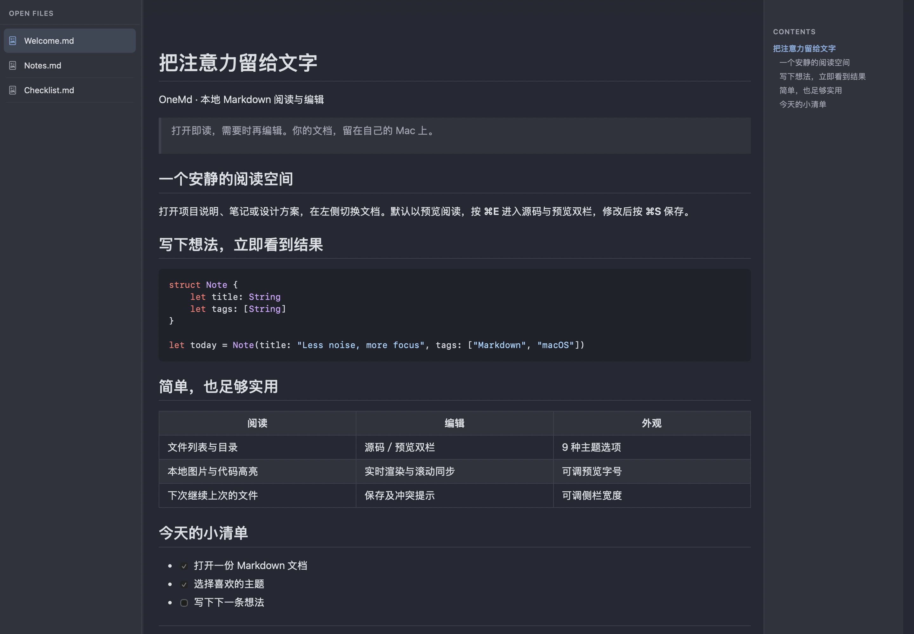
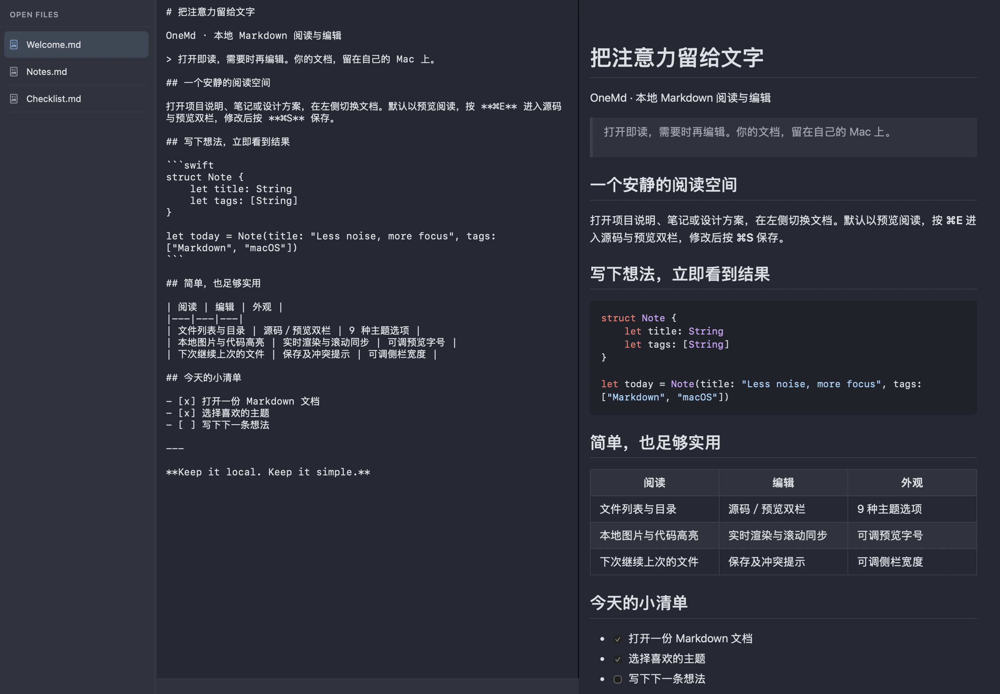
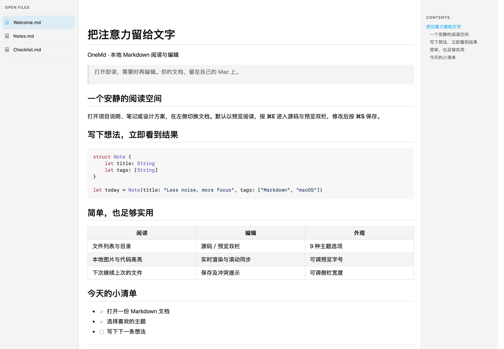

# OneMd

**打开即读，需要时再编辑。** 一款面向 macOS 的轻量本地 Markdown 阅读／编辑器，基于 [MarkView](https://github.com/paulhkang94/markview) 改造，使用 SwiftUI、AppKit 和 WebKit。

左侧只放已打开的文件，右侧默认显示预览；按 `⌘E` 切换源码与预览双栏。适合阅读项目文档、整理笔记，以及边写边看 Markdown。

**macOS 14+ · Apple Silicon · MIT · 0.1.0 预发布**



## 能做什么

- **专注阅读**：默认预览、宽屏目录、全宽排版，长代码和表格自动换行。
- **随时编辑**：源码／预览双栏、实时渲染、滚动同步、Prism 代码高亮。
- **多文件工作**：批量打开 Markdown、切换文件、拖动调整侧栏；下次启动恢复文件列表及选中项。
- **保护修改**：手动保存；外部修改自动重载，有未保存修改时提示冲突；关闭和退出前确认。
- **切换外观**：Dark、Light、System、Dracula、Nord、One Dark、Tokyo Night、Catppuccin Mocha、Solarized Light，共 9 种选项。
- **本地使用**：无需账号、订阅或后台服务；内置渲染资源，可离线阅读本地文档。



<details>
<summary>查看浅色阅读界面</summary>



</details>

截图来自真实 SwiftUI／WebKit 界面，使用仓库内的 [示例文档](examples/Welcome.md)。

## 下载与安装

从 [v0.1.0 Release](https://github.com/HaiBlueSea/OneMd/releases/tag/v0.1.0) 下载 [OneMd-0.1.0-macos-arm64.zip](https://github.com/HaiBlueSea/OneMd/releases/download/v0.1.0/OneMd-0.1.0-macos-arm64.zip)。GitHub 自动生成的 `Source code` 压缩包仅含源码，需要自行构建。

1. 解压 ZIP，把 `OneMd.app` 拖入「应用程序」。
2. 双击启动，按 `⌘O` 选择一个或多个 Markdown 文件。
3. 可下载同一 Release 的 `SHA256SUMS.txt`，在 ZIP 所在目录运行：

   ```bash
   shasum -a 256 -c SHA256SUMS.txt
   ```

**兼容范围**：macOS 14 或更高版本，Apple Silicon（M 系列）。当前二进制包不支持 Intel；Intel 源码构建尚未验证。

**首次打开**：当前为 ad-hoc 签名，未使用 Developer ID，也未经过 Apple 公证，下载后可能被 Gatekeeper 拦截。仅在确认下载来源和校验值后，按 [Apple 官方说明](https://support.apple.com/en-us/102445)，在「系统设置 → 隐私与安全性」中为该应用选择「仍要打开」。若系统提示恶意软件或完整性损坏，请停止使用并反馈。

## 怎么用

| 操作 | 方法 |
|---|---|
| 打开文件 | `⌘O`，支持多选；空白首页也提供打开按钮 |
| 阅读／编辑切换 | `⌘E` 或工具栏双栏按钮 |
| 保存 | `⌘S`；编辑不会自动写回原文件 |
| 关闭当前文件 | `⌘W`，有修改时确认 |
| 退出 | `⌘Q`，逐项处理未保存修改 |
| 调整外观 | 工具栏主题菜单；拖动侧栏分隔线调整宽度 |
| 预览字号 | `⌘+`／`⌘-`／`⌘0` 放大、缩小、重置 |
| 定位原文件 | 在预览中右键，选择在 Finder 中显示 |

支持 `.md`、`.markdown`、`.mdown`、`.mkd`、`.mkdn`、`.mdwn`。从 Finder 打开时，右键文件 →「打开方式」→ OneMd。若想设为默认程序，在「显示简介 → 打开方式」中选择 OneMd，再点「全部更改」；应用不会自行修改默认关联。

也可通过终端打开已安装的应用及文件：

```bash
open -a OneMd /path/to/a.md /path/to/b.md
```

遇到外部修改冲突时，可保留当前修改、重新加载磁盘内容，或在保存冲突提示中明确覆盖。未保存内容只在本次运行内保留，**会话恢复不恢复崩溃／强制退出前的草稿**。首次试用建议使用文档副本。

## 边界与隐私

当前聚焦已有 Markdown 文件的阅读和编辑，不提供目录树、云同步、Mermaid／数学公式渲染、PDF／HTML 导出、MCP 或 Quick Look 扩展。

应用不内置遥测、崩溃上传或自动更新。文档中的远程图片仍可能请求第三方服务器；点击外部链接会交给系统默认应用。预览会过滤常见危险 HTML，本地图片限制在文档目录及其子目录，但这不等于完整的恶意文档隔离。完整说明见 [安全与隐私](SECURITY.md)。

当前为早期预发布。软件按 MIT 许可证「按原样」提供，不承诺无缺陷或适合特定用途；重要文档请保留备份。已知验证边界见 [版本说明](docs/releases/0.1.0.md)。

## 从源码构建

需要 macOS 14+、Swift 6.1+、Python 3，以及提供对应 Swift 版本的 Xcode Command Line Tools 或 Xcode。首次构建需要联网获取锁定的 `swift-cmark` 依赖，后续运行不依赖开发工具。

下载或克隆**本仓库**后，在仓库根目录执行：

```bash
python3 scripts/build_mdos.py
open build/OneMd.app
```

产物为 `build/OneMd.app`，使用本机架构并进行 ad-hoc 签名。SwiftPM 脚本为当前验证入口；`project.yml` 为保留的 XcodeGen 配置，不作为发布入口。

验证命令：

```bash
python3 scripts/test_mdos.py --quick         # 文件保护、原生预览与主题
python3 scripts/test_mdos.py --sidebar-only  # 侧栏拖动与布局
python3 scripts/test_mdos.py                 # 另含释放循环与 60 秒资源观测
```

回归需要可用的 macOS 图形会话和 WebKit，不适用于 Linux 或纯终端容器。测试夹具与日志位于 `.tmp/`。

## 参与与致谢

Bug 和建议请提交到 [本仓库 Issues](https://github.com/HaiBlueSea/OneMd/issues)，附版本、系统、复现步骤及脱敏示例；请勿向上游 MarkView 报告本分支问题。

OneMd 由 [HaiBlueSea](https://github.com/HaiBlueSea) 维护，是独立衍生项目，与 MarkView、Apple 及主题名称对应项目无隶属或背书关系。感谢 Paul Kang 的 [MarkView](https://github.com/paulhkang94/markview)，保留上游 MIT 版权声明；各部分版权归相应权利人，维护者身份不代表拥有全部上游代码版权。渲染使用 swift-cmark，代码高亮使用 Prism。许可及当前图标来源见 [第三方声明](THIRD_PARTY_NOTICES.md)。
